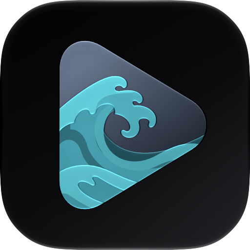

<h1>
<p align="center">
  
  <br>TIDALfast
</p>
</h1>
<p align="center">
  Finally, a better desktop TIDAL app. 
  <br>
  Focused on performance, small footprint and great UI feel without sacrificing modern UI niceties.
  <br>
  <br>
  <a href="#about">About</a>
  ·
  <a href="https://github.com/fdemb/tidalfast/releases">Download</a>
  ·
  <a href="#status">Status</a>
  ·
  <a href="CONTRIBUTING.md">Contributing</a>
</p>

<p align="center">
  
</p>

## About

TIDALfast is a TIDAL player written from scratch in Odin.

## Features

- **Lossless and hi-res.** TIDAL's FLAC streams, from CD quality up to 24-bit 192 kHz.
- **Gapless playback.** The next track downloads before the current one ends and plays straight after it, so live albums and DJ mixes play without a break.
- **Bit-perfect output.** On macOS the app can switch your DAC to each track's sample rate and bit depth and send it the samples unchanged. When a track can't play bit-perfect, the app tells you why.
- **ReplayGain.** By default albums played in order get album gain, and everything else gets track gain, so a playlist of singles plays at one level. The settings page can make it always track gain, always album gain, or off.
- **Your library.** Playlists, Liked Songs and followed artists from your account. Drag a song onto a playlist to add it, or click its heart to like it.
- **Search and artist pages.** Results for songs, albums, artists and playlists show as you type. Artist pages have top tracks, albums, EPs and singles, appearances and similar artists.
- **Media keys and Now Playing.** On macOS the keyboard's media keys and Control Center control playback.
- **Keyboard and VoiceOver.** Tab, the arrow keys and Enter reach every control, and VoiceOver reads them on macOS.
- **Every script.** Right-to-left text, emoji, and input methods for Japanese, Chinese and Korean in the search field.

## Download

Get it from [Releases](https://github.com/fdemb/tidalfast/releases). You need a TIDAL subscription.

The macOS app isn't notarized yet, so Gatekeeper blocks it the first time. Allow it in System Settings > Privacy & Security, or run:

```bash
xattr -dr com.apple.quarantine /Applications/TIDALfast.app
```

## Status

TIDALfast is in early pre-release, so expect rough edges.

## Contributing

To build TIDALfast from source or work on it, read [CONTRIBUTING.md](CONTRIBUTING.md). [docs/architecture.md](docs/architecture.md) explains how the app fits together.

TIDALfast isn't affiliated with or endorsed by TIDAL.
