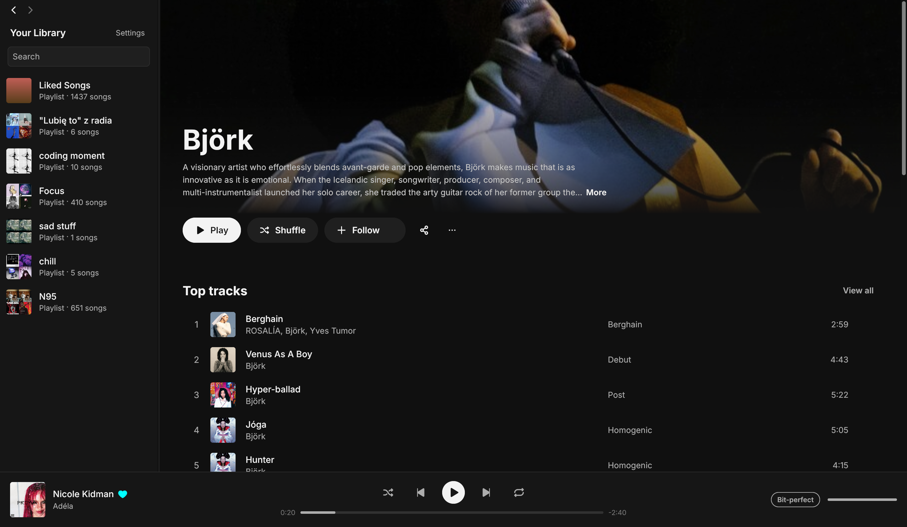

<h1>
<p align="center">
  
  <br>TIDALfast
</p>
</h1>
<p align="center">
  A native TIDAL client for macOS and Linux.
  <br>
  Focused on performance, small footprint and great UI feel without sacrificing modern UI niceties.
  <br>
  <br>
  <a href="#about">About</a>
  ·
  <a href="https://github.com/fdemb/tidalfast/releases">Download</a>
  ·
  <a href="#status">Status</a>
  ·
  <a href="CONTRIBUTING.md">Contributing</a>
</p>

<p align="center">
  
</p>

## About

TIDALfast is a TIDAL player written from scratch in Odin. It doesn't embed a browser. It draws its own UI on the GPU, with Metal on macOS and Vulkan on Linux, and decodes FLAC itself.

On an M1 MacBook Air it shows your library about 180 ms after launch. It takes about 70 MB of memory at start and stays under 100 MB while it plays. An idle window uses no CPU, because the app draws only when something changes. The numbers and how they were measured are in [docs/measuring.md](docs/measuring.md).

## Features

- **Lossless and hi-res.** TIDAL's FLAC streams, from CD quality up to 24-bit 192 kHz.
- **Gapless playback.** The next track downloads before the current one ends and plays straight after it, so live albums and DJ mixes play without a break.
- **Bit-perfect output.** On macOS the app can switch your DAC to each track's sample rate and bit depth and send it the samples unchanged. When a track can't play bit-perfect, the app tells you why.
- **ReplayGain.** Albums played in order get album gain, and everything else gets track gain, so a playlist of singles plays at one level.
- **Your library.** Playlists, Liked Songs and followed artists from your account. Drag a song onto a playlist to add it, or click its heart to like it.
- **Search and artist pages.** Results for songs, albums, artists and playlists show as you type. Artist pages have top tracks, albums, EPs and singles, appearances and similar artists.
- **Media keys and Now Playing.** On macOS the keyboard's media keys and Control Center control playback.
- **Keyboard and VoiceOver.** Tab, the arrow keys and Enter reach every control, and VoiceOver reads them on macOS.
- **Every script.** Right-to-left text, emoji, and input methods for Japanese, Chinese and Korean in the search field.

## Download

Get the `.dmg` (macOS 14 or later, Apple silicon) or the AppImage (Linux on Wayland with PipeWire, x86_64) from [Releases](https://github.com/fdemb/tidalfast/releases). You need a TIDAL subscription.

The macOS app isn't notarized yet, so Gatekeeper blocks it the first time. Allow it in System Settings > Privacy & Security, or run:

```bash
xattr -dr com.apple.quarantine /Applications/TIDALfast.app
```

## Status

TIDALfast is in early pre-release, so expect rough edges.

On Linux, bit-perfect output, media keys, Now Playing and screen readers aren't done yet. On compositors without server-side decorations, such as GNOME, the window has no title bar. Windows has a first build, cross-compiled from macOS or Linux, without bit-perfect output, Now Playing or screen readers yet; [docs/windows.md](docs/windows.md) has how to build it.

## Contributing

To build TIDALfast from source or work on it, read [CONTRIBUTING.md](CONTRIBUTING.md). [docs/architecture.md](docs/architecture.md) explains how the app fits together.

TIDALfast isn't affiliated with or endorsed by TIDAL.
